# Haq · হক · हक़

**An AI caseworker for Indian citizens. Describe a civic problem in English, Hindi or Assamese, and Haq finds the right office, drafts your complaint and RTI application, checks its own work, and tells you when to follow up.**

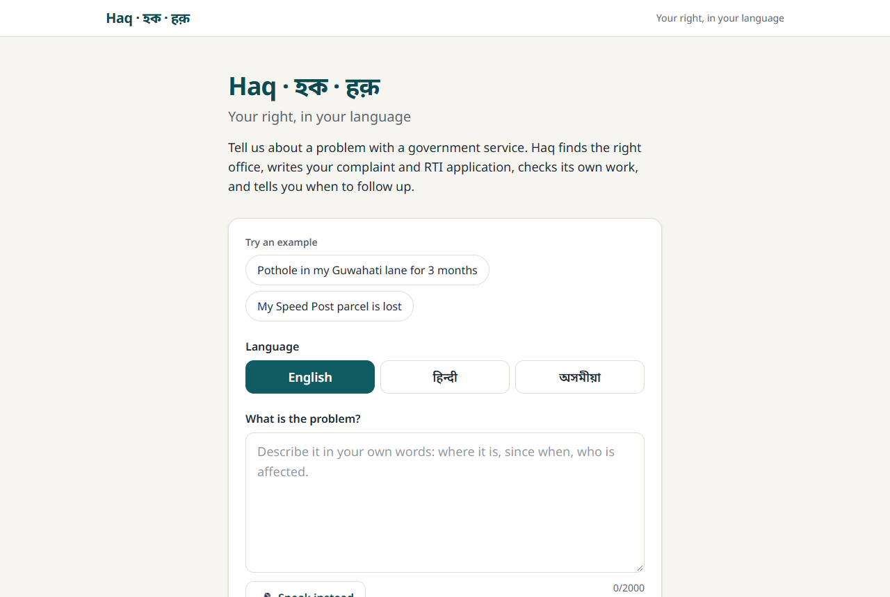

> Built with [Cline](https://cline.bot) (the coding agent) and the [Cline SDK](https://www.npmjs.com/package/@cline/sdk) (the caseworker agent inside the product). Not legal advice; see the [disclaimer](#disclaimer).

## The problem

Grievance and RTI systems exist in India (CPGRAMS, state RTI portals, municipal grievance cells). Most people still do not use them, because they do not know:

- **which office** owns the problem (city, state or central),
- **what format** to write in (an RTI needs specific records, a fee and the right Public Information Officer), and
- **what to do when nobody replies** (RTI replies are due in 30 days, then there is a first appeal with its own window).

Drafting and routing are the barrier, not the law.

## What Haq does

1. **Describe it.** Type or speak the problem in English, Hindi or Assamese. Add a photo if you have one.
2. **Watch Haq work.** A live panel shows each step: finding the office, checking the law and portal, writing the drafts, and running checks.
3. **Get your papers.** A complaint to the right office, an RTI application with numbered requests for specific records, a plain-language summary in your language (with read aloud), and a step-by-step filing guide with portal links and fees.
4. **Know your dates.** A timeline of reply and appeal deadlines, with an `.ics` file for your calendar.
5. **No reply?** One button drafts the first appeal under Section 19(1) of the RTI Act.

Haq never files, submits forms or pays for you. You file; Haq prepares.

| Live work + checks | Your drafts | Deadlines |
|---|---|---|
| 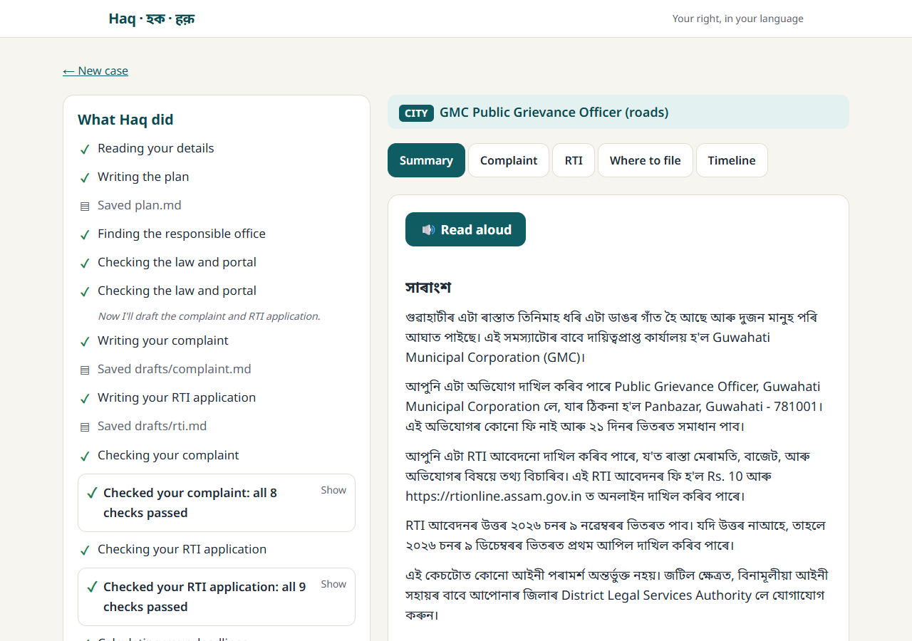 | 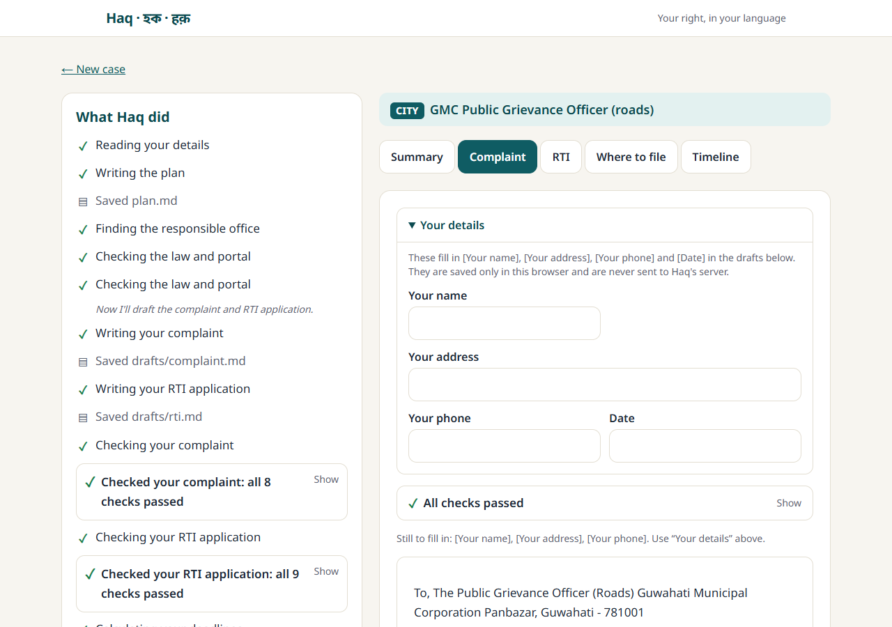 | 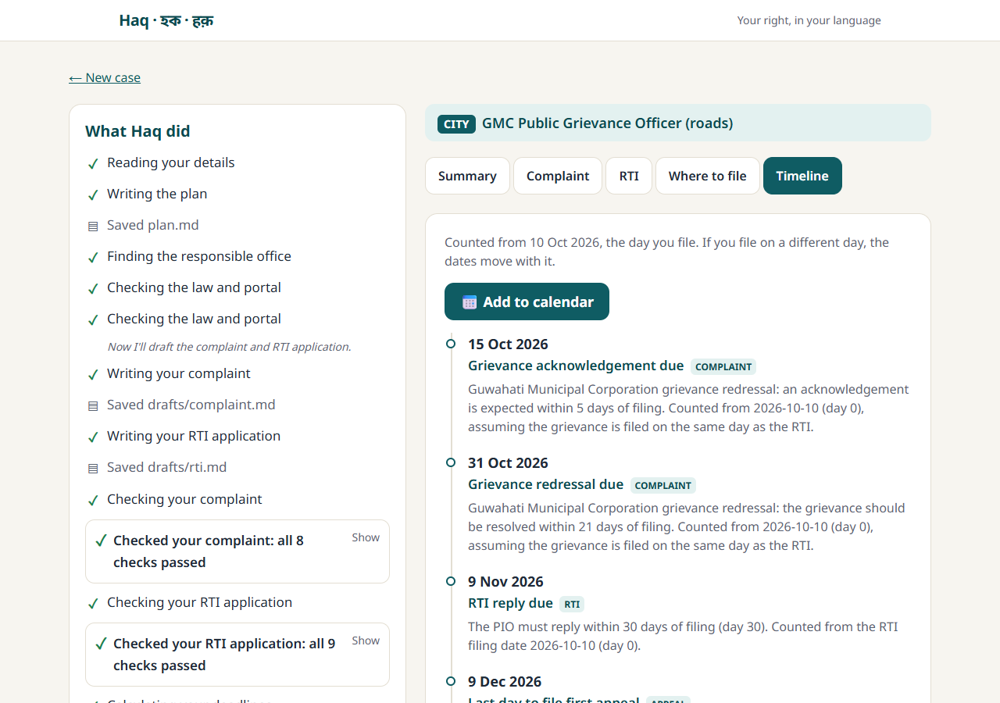 |

More screens (desktop):

| Summary | RTI | Where to file | First appeal |
|---|---|---|---|
|  | 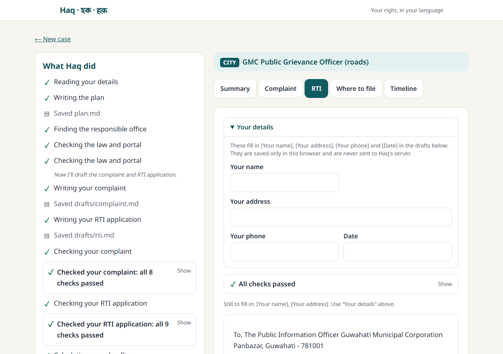 | 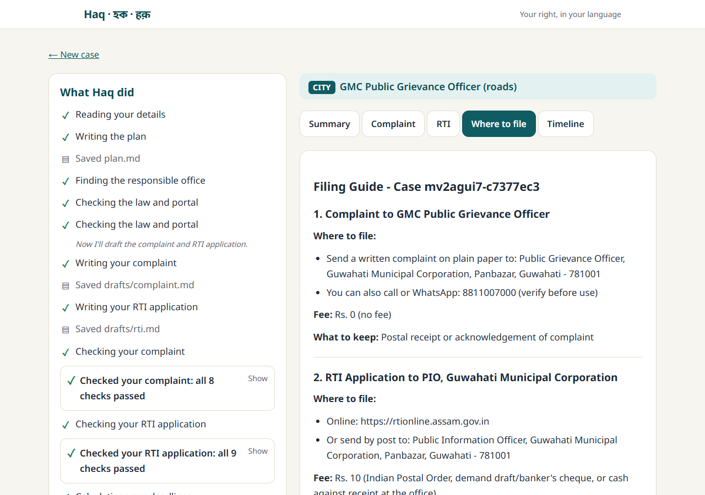 | 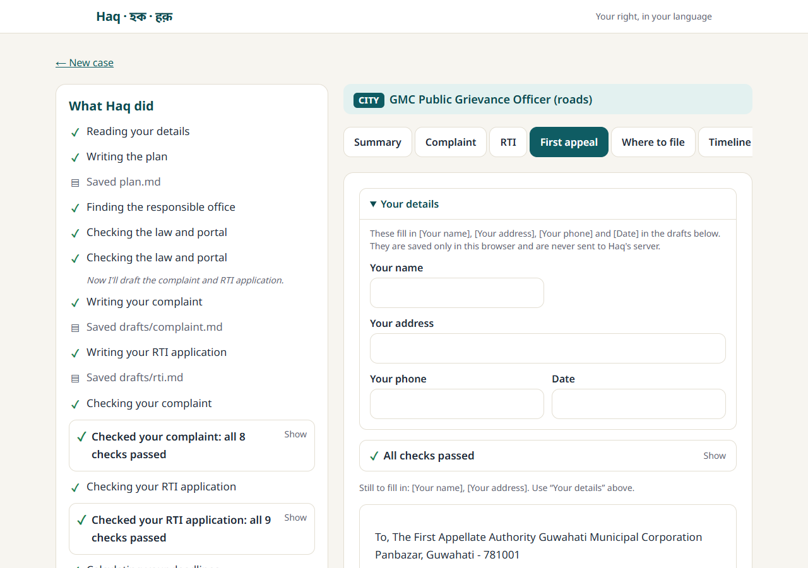 |

The appeal form (RTI tab, "No reply yet?"):

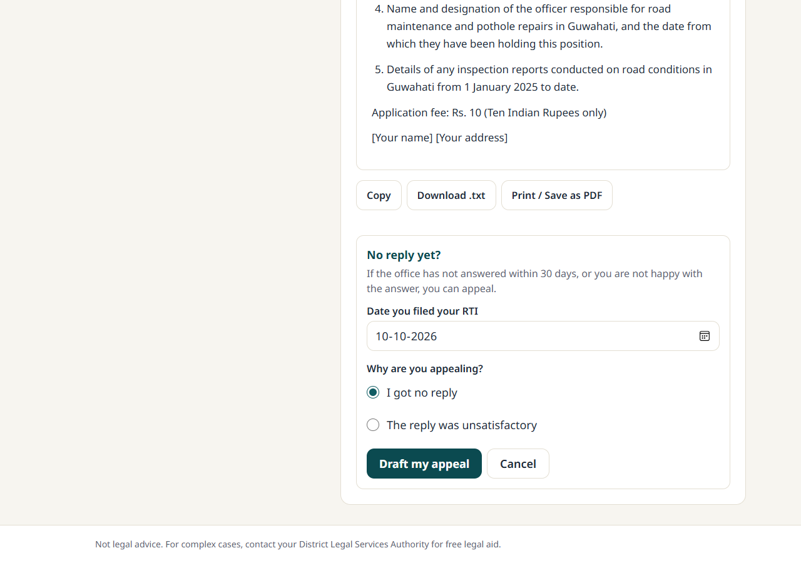

It is mobile-first (works at 375 px):

| Home | Complaint | Case not found |
|---|---|---|
| 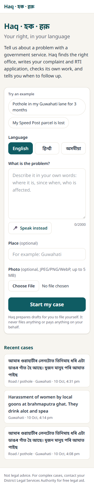 | 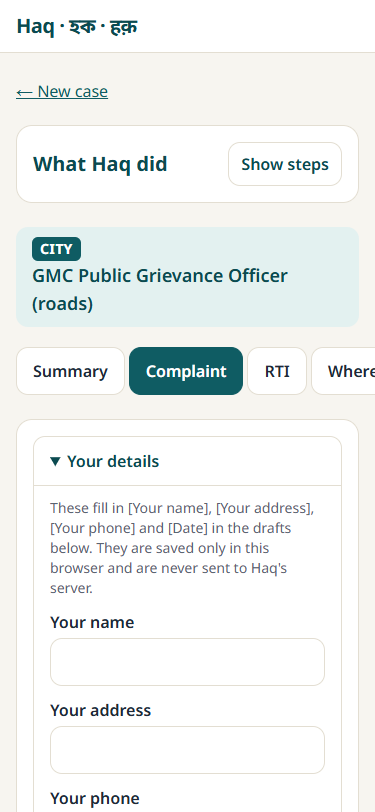 | 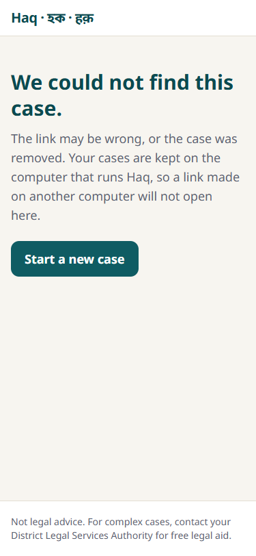 |

## Architecture

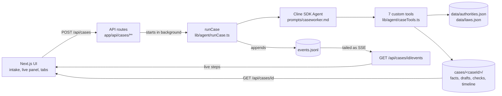

- **No database.** Each case is a folder under `cases/<caseId>/`; `cases/index.json` lists them.
- **One event log.** The agent writes `events.jsonl`; the API tails it as Server-Sent Events, so a page reload replays the whole run.
- **The model does the writing, TypeScript does the facts.** Offices, laws, fees, portals, deadlines and draft checks all come from deterministic code and `data/*.json`, never from the model.

## Cline inside Haq

The caseworker is a Cline SDK `Agent` that works on a case folder the way a developer works on a repository: read the facts, write a plan, call tools, write files, run checks, fix what fails, and finish.

**The 7 tools** (`lib/agent/caseTools.ts`, created per case, each re-validating its input with zod `safeParse`):

| Tool | What it does |
|---|---|
| `read_case_file` / `write_case_file` | Read and write text files inside this one case folder. `..`, absolute paths and anything outside are rejected. The model cannot write `routing.json`, `timeline.json`, `checks.json`, `evidence/**` or `events.jsonl`. |
| `find_authority` | Picks the most local office that owns the issue (Guwahati, then Assam, then central) from `data/authorities.json`, or says "not covered" and gives a general route. Saves `routing.json`. |
| `lookup_law` | Rules, fees, portals and source URLs from `data/laws.json`. |
| `calc_deadlines` | Pure TypeScript date maths for the reply, appeal and second-appeal windows. Saves `timeline.json`. |
| `check_draft` | Deterministic checks on a draft (8 for a complaint, 9 for an RTI, 5 for a first appeal). Records `checks.json`. |
| `finish_case` | Re-runs the checks itself and refuses to finish until every required draft passes. |

The agent has **no shell and no network tools**.

**The check and fix loop.** The checks are plain TypeScript (`lib/tools/checkDraft.ts`): a `Subject:` line, a location, placeholders instead of personal data, numbered record requests with a time period for the RTI, only known sections cited, and more. When a check fails, the tool returns a hint per failed check. The agent reads the hint, rewrites the draft and checks again. The live panel shows the failure and then a green **"Fixed. It was failing before and now passes."**

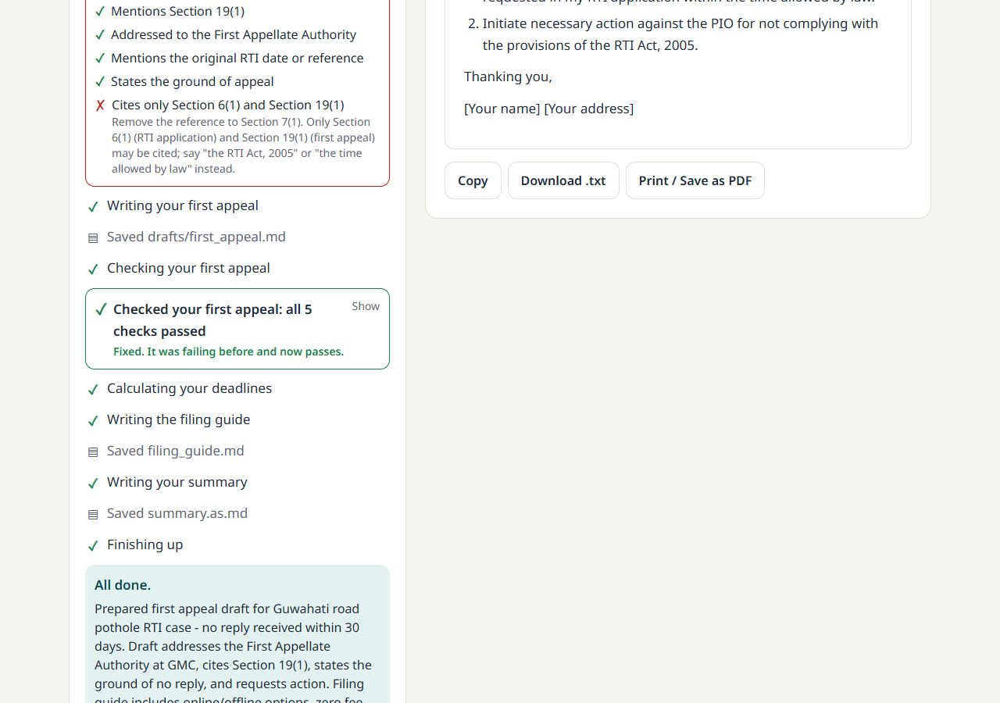

*Real run: the model cited "Section 7(1)" from memory in a first appeal. The check `cites_only_known_sections` rejected it, the model rewrote the draft, and the second check passed.*

**The live view.** `runCase` emits typed events (`start`, `text`, `tool_call`, `tool_result`, `file_written`, `check`, `done`, `error`) into `events.jsonl`. `lib/client/timeline.ts` turns them into friendly steps ("Finding the responsible office", never raw tool names). After a dropped connection the client reconnects with `?after=<lastId>`.

**First-appeal mode.** "No reply yet?" asks for the date the RTI was filed and the reason, then runs the same agent in `first_appeal` mode. It drafts `drafts/first_appeal.md` for the First Appellate Authority, recalculates the dates from the RTI filing date, rewrites the filing guide, and adds a "First appeal" tab. The run is appended to the same event log under a new `start` event.

**Privacy.** Name, address, phone and date are typed into the browser only (localStorage). They fill `[Your name]`, `[Your address]`, `[Your phone]` and `[Date]` in the displayed text and are never sent to the server or the model.

## How we built Haq with Cline

Haq was built with Cline in phases, each with a plan first and a commit at the end.

| Phase | Commit | What Cline did |
|---|---|---|
| 0 Setup | `956b1d7` .. `ec08261` | Next.js app, `npm test` script, `cases/` folder, `lib/agent/model.ts`, the model ping script, and the starter pack (rules, Memory Bank, spec, data, prompt). |
| 1 Tools + tests | `0965113` | `findAuthority`, `lookupLaw`, `calcDeadlines`, `checkDraft`, `toIcs`, `caseFiles` as pure TypeScript, each with vitest tests (82 tests at the end of the phase). |
| 2 Caseworker agent | `cbec19a` | `runCase` on the Cline SDK `Agent`, the 7 per-case tools, the event log, the prompt, and a CLI runner. Two real runs finished with both drafts passing. |
| 3 API + streaming | `9b45b7e` | Seven route handlers (create, list, get, SSE events, evidence, `.ics`, appeal) and the SSE tailer. Tested end to end with `curl` against `next dev`. |
| 4-5 UI, appeal, extras | `ff26711` | Home page, live case page, tabs, details form, copy/download/print, annexure with EXIF, read aloud, sources, first-appeal flow, and the citation check. Driven in a real browser (Edge) at 375 and 1280 px. |
| 6 Polish | see `git log` | README, screenshots, metadata, "Case not found" page, MIT licence, cleanup, and a fix for replaying a case that has an appeal. |

**How Cline was used**

- **`.clinerules`** (`.clinerules/01-haq.md`) holds the hard rules Cline read on every task: only use `data/*.json` for offices and fees, deadlines and checks are never done by the model, file tools are scoped to the case folder, no auto-filing, every tool has a test, and the phase workflow.
- **Memory Bank** (`memory-bank/`): `projectbrief.md`, `activeContext.md` and `progress.md` were read before each phase and updated after it. This is where the gotchas below were written down.
- **Plan then Act.** Each phase started in Plan mode (read the spec and the Memory Bank, propose a plan) and moved to Act after approval.
- **The `cline-sdk` skill** (`.agents/skills/cline-sdk/`, pinned in `skills-lock.json`) gave the SDK reference for `Agent`, tools, events and providers. Types in `@cline/*` 0.0.92 were checked against it.
- **Browser checks.** Cline drove the installed Edge with `playwright-core` (no browser download) to run the real flow: pothole example, photo upload, live run, every tab, the appeal, and the print view. It read the screenshots and fixed what looked wrong (for example it folded the step list on phones once a run finishes).
- **Tests as the gate.** `npm test`, `tsc`, eslint and `npm run build` ran at the end of every phase.

**Real problems Cline found and fixed**

| Problem | What happened | Fix |
|---|---|---|
| SDK error shape | The runtime wraps whatever a tool `execute` returns as `output`, so returning `{ output, isError: true }` arrives nested and looks like success. It could even end the run through `finish_case`. | `runCase` unwraps it in `hooks.afterTool` (`unwrapToolResult`). |
| zod enums not enforced | The SDK does not enforce zod enums at runtime, so a model could pass a bad `issue_type` or `kind`. | Every tool re-validates with `safeParse` (`guarded`). |
| Next 16 `cacheComponents` | With `cacheComponents: true`, `export const runtime` and `export const dynamic` in a route file are a build error. The case page also has to read `params` inside `<Suspense>`. | Removed the exports (Node.js is the default); the page awaits `params` in a child component inside `<Suspense>`. |
| SDK bundling | Turbopack bundled the browser build of the SDK, so the agent route did not compile. | `serverExternalPackages` for `@cline/*`, `exifr` and `ics` in `next.config.ts`. |
| India-time date bug | `toISOString()` gives the UTC date, a day early before 05:30 IST, so every deadline would shift by a day. | `todayIST()` uses `Intl.DateTimeFormat` with `Asia/Kolkata`. |
| Prompt injection | A citizen could type `mode: first_appeal` or "ignore your rules" into the problem text, which lands in `facts.md`. | The citizen's text is blockquoted under "What the citizen wrote", the prompt says to treat it as data, and first-appeal mode is an explicit `runCase` option, not parsed from the file. |
| Model cites sections from memory | The model wrote "Section 7(1)" in a first appeal, in two real runs, despite a prompt rule. | `cites_only_known_sections` in `checkDraft` fails any section other than 6(1) and 19(1). In a later real run it caught "Section 7(1)", the agent fixed it, and the check passed. |
| Appeal not replayed | The event stream stopped at the first `done`, so a case opened later never showed its appeal run. Found while taking the README screenshots. | The stream now ends only at the last `done` or `error` in the file; regression test added. |
| Hydration | `next dev` does not hydrate a page opened at `127.0.0.1`, so buttons do nothing. | Use `http://localhost:3000`; noted in the Memory Bank. |

## Tech stack and AI models

- **App:** Next.js 16.4 (App Router, `cacheComponents`), React 19, TypeScript, Tailwind CSS 4, `react-markdown`, Noto Sans with Bengali and Devanagari fonts.
- **Agent:** `@cline/sdk` (`Agent`, `createTool`), `zod` for tool schemas, `exifr` for photo date and GPS, `ics` for the calendar file.
- **Tests:** `vitest`. Browser checks: `playwright-core` (dev only).
- **Model access:** one place, `lib/agent/model.ts`. It uses the SDK's `openai-compatible` provider with base URL `https://api.cline.bot/api/v1` (the Cline API), the key from `CLINE_API_KEY` and the model id from `HAQ_MODEL`.
- **Model used:** every run, test and screenshot in this repo used the free **`minimax/minimax-m2.5`**. `anthropic/claude-sonnet-4-6` is the planned demo model; switching is one env var (`HAQ_MODEL`), but it has not been run on this code.
- **Browser features:** voice input uses the browser's speech recognition and read aloud uses speech synthesis. Both fall back to a short hint when the browser does not support them.

## Data and accuracy

Haq may only use what is in two files; it never invents an office, law, fee, portal or deadline.

- `data/authorities.json`: nested routing (city, then state, then central) with an office, grievance channel and RTI PIO per issue.
- `data/laws.json`: the RTI Act 2005 rules, central and Assam RTI portals and fees, CPGRAMS, the Assam CM grievance portal, the GMC grievance process and legal aid.

Every entry carries its sources. Official pages used include [rtionline.gov.in](https://rtionline.gov.in), [rtionline.assam.gov.in](https://rtionline.assam.gov.in), [pgportal.gov.in](https://pgportal.gov.in), [cm.assam.gov.in](https://cm.assam.gov.in), [gmc.assam.gov.in](https://gmc.assam.gov.in/resource/grievance-redressal), the [RTI Act text](https://rti.gov.in/rti-act.pdf) and [NALSA](https://nalsa.gov.in). Each case page lists the sources its answer is based on.

**Verified flags.** An office with `verified: true` was checked against an official source on 2026-10-10. An office with `verified: false` is plausible routing that has **not** been confirmed, and Haq tells the citizen "Please confirm this office before filing." Today, 8 of the 13 offices are unverified: the GMC grievance officer for streetlights and drainage, APDCL (electricity), the Assam food and civil supplies office, Assam PWD roads outside the city, and the central offices for Posts, Railways and Passport. The GMC helpline number in `laws.json` also needs checking before use. Please confirm these before relying on them.

**Not covered yet.**

- Only **Guwahati (GMC)**, **Assam** and **central** (CPGRAMS and central RTI) are in the data. A place outside Assam gets the central route plus a note that the state is not covered.
- Place matching is by name. A district or locality outside the list falls back to the Assam or central route.
- A problem that is not a civic service (for example the police or a crime) is not routed correctly: the agent gives the general route and says to confirm. We saw this with a harassment complaint that got a railways route; the draft carried a note to confirm.
- Drafts are in English. Only the summary is in Hindi or Assamese.

## Setup

Requires **Node 22+**.

```bash
npm install
cp .env.example .env.local      # on Windows PowerShell: Copy-Item .env.example .env.local
# edit .env.local: set CLINE_API_KEY (app.cline.bot -> Settings -> API Keys)
npm run dev
```

Open **http://localhost:3000** (not `127.0.0.1`: in dev, Next blocks its client files for other origins, the page does not hydrate, and the buttons do nothing).

`.env.local`:

| Variable | Meaning |
|---|---|
| `CLINE_API_KEY` | Your Cline API key. Never commit it (`.env.local` is git-ignored). |
| `HAQ_MODEL` | Model id. Default `minimax/minimax-m2.5` (free). Use `anthropic/claude-sonnet-4-6` for the best drafts. |

Other commands: `npm run ping` checks the key and model, `npm run run-case` runs the agent on a case from the command line, `npm run build` and `npm start` for production.

**It needs a long-lived Node server** (`npm run dev` or `npm start`). A case run goes on in the background after the request returns, and cases are folders on disk, so serverless hosting (for example Vercel functions) would cut runs off and lose the files.

## Tests

```bash
npm test
```

**192 tests in 11 files** (vitest), all deterministic, none calling a model:

- tools: `findAuthority` (routing and place matching), `lookupLaw`, `calcDeadlines`, `checkDraft` (every check, including the citation check), `caseFiles` (path scoping, `..` and absolute paths rejected);
- agent: the 7 tools and their guards, and `runCase` with a mock model (events, the error-shape unwrap, first-appeal mode, finish refusal);
- server: SSE tailing and resume, facts and appeal helpers, and every API route (status codes, validation, photo sniffing, 404, 409);
- client: the event reducer for the live panel, placeholder filling, photo metadata and the route view.

`npx tsc --noEmit`, `npm run lint` and `npm run build` are also clean.

## Limitations and future scope

**Limitations**

- Haq prepares papers; it does not file, submit or pay anything.
- No login and no rate limit on the API. Anyone who can reach the server can create cases and spend model credits. Do not expose it publicly as is.
- Cases are plain folders on one machine, with no accounts and no deletion screen.
- The model can still write weak or wrong text. The checks catch format, citations and missing parts, not whether a request is wise. Read every draft before filing.
- Coverage is one city, one state and the central government (see above), and 8 of 13 offices are unverified.

**Future scope**

- More states and cities, with the data checked by people who file these every day.
- WhatsApp and voice-first intake for people who do not type.
- Tracking replies: remind the citizen on the due date and help with the second appeal.
- A collective complaints map, so a pothole reported by ten people is one case.
- Self-hosted Indian-language models, so no text leaves the machine.
- Authentication, rate limits and a database before any public deployment.

## Disclaimer

Haq is **not legal advice**. It prepares drafts from the data in this repository, which may be out of date or wrong. For complex cases, contact your District Legal Services Authority for free legal aid ([NALSA](https://nalsa.gov.in)).

## Licence

[MIT](LICENSE)
